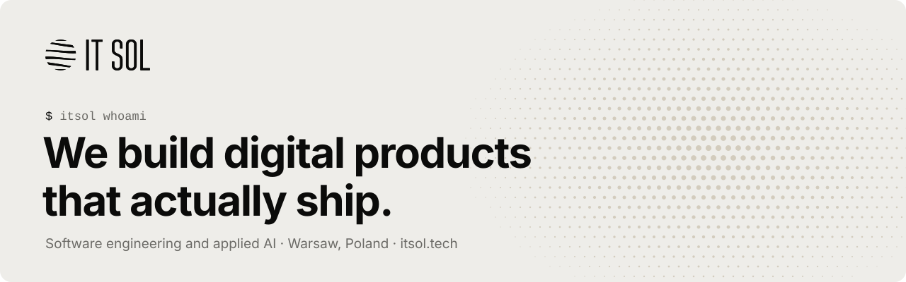

<a href="https://itsol.tech">
  <picture>
    <source media="(prefers-color-scheme: dark)" srcset="https://raw.githubusercontent.com/itsoltech/.github/main/profile/assets/banner-dark.svg">
    
  </picture>
</a>

IT SOL is a senior-only software team from Warsaw. We work with enterprise teams and founders on whole products: scoping and architecture, backend, frontend, infrastructure and applied AI running in production. One team owns the product from the first scope to long-term maintenance, and clients talk directly to the engineers who build it.

We publish some of the tools we build for our own work.

[itsol.tech](https://itsol.tech) · [hello@itsol.tech](mailto:hello@itsol.tech)

## Canopy

<a href="https://github.com/itsoltech/canopy"></a>

Canopy by IT SOL is a self-hosted workspace for AI coding agents. Run Claude Code and Codex on your own computer or server and follow their work from desktop, web, or mobile.

Canopy is free for personal and commercial use. Your model provider may charge separately for a subscription or API usage.

[Download Canopy](https://canopy.itsol.tech/#download) · [Repository](https://github.com/itsoltech/canopy) · [Migrate from Canopy Desktop](https://canopy.itsol.tech/migrate/)

## basal-rs

An inference engine and HTTP server in Rust for [Basal](https://github.com/rkinas/basal), the decision models built by Remek Kinas on top of Bielik. The models, their training and the decision protocol are his work. We wrote the runtime: our own CUDA and Metal kernels, request packing into a shared prefix tree, and a server scheduler, with no Python at runtime. The server implements the TypeSafe System One API and an endpoint compatible with the upstream server.

basal-1.5-max (11B) at 32 concurrent clients, upstream v1.5.0 `fast` mode on the same card:

| GPU | Upstream | basal-rs |
|---|---:|---:|
| H100 80 GB | 56 req/s | 85 req/s |
| A100 80 GB | 24 req/s | 41 req/s |
| L40S | 18 req/s | 36 req/s |
| RTX 6000 Ada | 10 req/s | 27 req/s |

On 900 questions from nine public datasets, basal-rs in default f16 makes the same decision as the upstream FP32 reference in 899 or 900 cases, depending on the model. The only differences are near-ties in FP32, such as 0.503 against 0.497. On an Apple M2 Max it makes about twice as many decisions per second as the MLX backend. Method and raw data are in the [reports](https://github.com/itsoltech/basal-rs/tree/main/reports).

```sh
brew install itsoltech/tap/basal-rs   # Apple Silicon; Linux + NVIDIA: install.sh or Docker
basal serve
```

[](https://github.com/itsoltech/basal-rs/releases/latest) [](https://github.com/itsoltech/basal-rs/blob/main/LICENSE) [](https://github.com/itsoltech/basal-rs)

[Repository](https://github.com/itsoltech/basal-rs) · [Benchmarks](https://github.com/itsoltech/basal-rs/blob/main/docs/PERFORMANCE.md) · [Basal upstream](https://github.com/rkinas/basal)

## Smaller tools

| Repository | |
|---|---|
| [jev-code-review](https://github.com/itsoltech/jev-code-review) | GitHub Action and CLI that review pull requests with TypeSafe Jev. Rules, thresholds and the merge verdict live in a YAML file in the repository. |
| [agents](https://github.com/itsoltech/agents) | Plugin marketplace for Claude Code and Codex with the skills and subagents our engineers use every day. |
| [homebrew-tap](https://github.com/itsoltech/homebrew-tap) | Homebrew formulas for our command-line tools. |

## What we work with

| Area | Tools |
|---|---|
| Backend | .NET, Rust, Node.js, Go, Python |
| Frontend | React, Next.js, Svelte, Angular |
| Mobile | React Native, Flutter |
| AI | OpenAI, Anthropic, Hugging Face, Qdrant, Pinecone |
| Data | PostgreSQL, SQL Server, MongoDB, Redis |
| Infrastructure | Docker, Kubernetes, Terraform, AWS, Azure |

Our applied AI work covers LLM automation, RAG pipelines, document processing (OCR, classification, extraction), semantic search and on-premise deployment of models.

---

If you need a team that cares about the product as if it were its own, write to [hello@itsol.tech](mailto:hello@itsol.tech).

If you only need someone to close tickets, we're probably not your team.

<sub>IT SOL Sp. z o.o. · Górna Droga 5/6, 02-459 Warsaw, Poland</sub>
